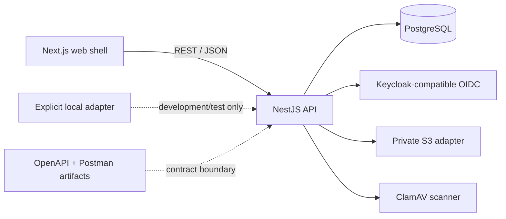

# Expense Tracker

Expense Tracker is a family-oriented application for personal and shared-household finance. Its approved product scope includes income and expense tracking, transfers between users in the same Shared Wallet, refunds, recurring transactions, budgets, reports, notifications, attachments, auditability, and offline/PWA workflows.

The repository is actively implemented but is not release-complete. Several server-side slices have disposable end-to-end evidence; the web client now has a complete navigable route surface with locally testable demo interactions, while authenticated API wiring, runtime localization/RTL, offline synchronization, production storage verification, backup/restore, and release verification remain incomplete or decision-gated.

## Project overview

### Implemented and verified

- pnpm workspace with separate Next.js web and NestJS API applications.
- PostgreSQL schema and reviewed SQL migrations for identity, Shared Wallet membership, roles, accounts, ledger records, refunds, recurring transactions, budgets, notifications, transfers, and attachments.
- Keycloak-compatible OIDC JWT validation using issuer, audience, and JWKS checks.
- First-user Shared Wallet/Admin bootstrap, one financial account per user, explicit Member/custom roles, and server-side permission checks.
- Exact integer minor-unit ledger arithmetic, account balances, idempotency, optimistic versions, audit events, income/expense operations, refunds, recurring generation, and same-wallet user-to-user transfers with linked debit/credit legs.
- Budget persistence/evaluation and durable in-app notification list/read operations.
- Private S3-compatible attachment storage as the production-default adapter, plus an explicitly selected local adapter for development/test use.
- Server-side JPG/PNG/PDF byte validation, 10 MB limit, ClamAV `clamd` integration boundary, fail-closed scanning, quarantine, authorization, audit records, and seven-year post-archive attachment retention/purge logic.
- OpenAPI and local Postman artifacts for the currently covered API surface.

### Partial, planned, or externally unverified

- Browser login/callback, persistent application sessions, revocation, and the complete authorization matrix are not fully proven. The repository currently lacks the Keycloak browser client ID and redirect configuration required for a real PKCE exchange.
- The web application has routes and interactions for the main finance workflows plus a separate `/welcome` marketing page, backed by an explicitly gated development-only adapter; authenticated API wiring, complete translated copy, accessibility evidence, and browser RTL/theme proof are not fully verified.
- A service worker, IndexedDB/Dexie outbox, synchronization API, conflict UI, and complete PWA behavior are not implemented.
- Reports/exports, external notification delivery, backup/restore, CI, deployment, and production hosting are not implemented.
- Local attachment integration is verified, but real AWS S3/IAM/bucket-policy/encryption/network behavior and a live ClamAV daemon still require external verification.

The authoritative phase-by-phase status is maintained in [`EXECUTION_TRACKER.md`](EXECUTION_TRACKER.md).

## Technology stack

| Area                | Technology                                                                           | Role and current status                                                                                                                                         |
| ------------------- | ------------------------------------------------------------------------------------ | --------------------------------------------------------------------------------------------------------------------------------------------------------------- |
| Workspace           | pnpm `10.12.4`                                                                       | Monorepo package management and recursive scripts.                                                                                                              |
| Runtime             | Node.js `24.11.1` pin; engine `>=24.0.0 <25.0.0`                                     | Required project runtime. The recorded verification environment used Node `26.8.1`, so Node 24 compatibility is still an open verification item.                |
| Web                 | Next.js `15.5.6`, React `19.1.1`, TypeScript `5.9.3`                                 | App Router application routes, shared shell, forms, tables, and future PWA client.                                                                              |
| API                 | NestJS `11.1.6` with Fastify platform                                                | Modular REST API, guards, controllers, and application services.                                                                                                |
| Database            | PostgreSQL; `postgres` driver                                                        | Authoritative relational store for identity, wallet, ledger, audit, notification, and attachment metadata. Disposable PostgreSQL is provided by Docker Compose. |
| ORM/data access     | Drizzle ORM `0.44.5` plus reviewed SQL migrations                                    | Typed schema/query access and visible SQL constraints/migrations.                                                                                               |
| Shared domain       | `@expense-tracker/domain`                                                            | Exact-money, account, and permission logic shared by the workspace.                                                                                             |
| Contracts           | `@expense-tracker/contracts`, OpenAPI YAML, Postman collection                       | Versioned API shapes, synchronization/conflict types, and local request artifacts. The contract is intentionally incomplete.                                    |
| Localization        | `@expense-tracker/localization`                                                      | Supported locale list (`en`, `fr`, `ar`) and direction helper. Full UI localization is not implemented.                                                         |
| Authentication      | `jose` with Keycloak-compatible OIDC/JWKS                                            | Server-side JWT validation. Browser client configuration, login callback, and session lifecycle are not yet available in the repository.                        |
| Object storage      | AWS SDK for JavaScript S3 client                                                     | Private S3-compatible attachment adapter; configured as the default production driver.                                                                          |
| Development storage | Configurable local filesystem adapter                                                | Isolated local contract testing only; it does not replace the production S3 design.                                                                             |
| Malware scanning    | ClamAV `clamd` INSTREAM adapter; test scanner only in `NODE_ENV=test`                | Fail-closed upload scanning and quarantine. A live ClamAV daemon has not been verified.                                                                         |
| Testing             | Vitest, TypeScript checks, disposable Docker services, API smoke/integration scripts | Domain/API/package tests and disposable API evidence. Playwright is not currently present.                                                                      |
| API tooling         | OpenAPI YAML and local Postman collection                                            | Contract/request artifacts under `packages/contracts` and `postman`; the contract checker validates collection structure, not live API behavior.                |

## Architecture

The repository is a pnpm workspace. The API is a NestJS modular monolith backed by PostgreSQL. The web application is a Next.js App Router application with a shared shell and route-level workflow pages. Shared packages hold domain rules, database access, contracts, and localization primitives.



### Main workflows

- Identity provisioning creates the first Shared Wallet, Admin role, membership, and one MAD-base financial account. Later identities receive explicit least-privilege membership behavior.
- Ledger writes use exact integer minor units, database transactions where multiple records must change together, idempotency keys, optimistic versions, and audit events.
- A transfer between two users in one Shared Wallet creates linked debit and credit legs against their existing accounts and is excluded from income/expense classification.
- Refunds reference an original transaction and enforce full/partial refund limits. Recurring templates support duplicate-safe occurrence generation.
- Attachment bytes are validated and scanned before storage. Only clean, authorized records are downloadable. Archived transactions calculate `retention_until` as seven years after archival; purge deletes the object before metadata.
- Budget evaluation can create durable in-app notifications with duplicate-threshold protection. A complete event/outbox worker is not yet implemented.

### Planned architecture not yet implemented

The technical design proposes IndexedDB/Dexie local state, a service worker, an idempotent mutation outbox, explicit conflict states, background workers/outbox processing, Web Push/email delivery, and a complete PWA. These remain design direction or open implementation work; the current repository does not provide those runtime components.

## Design system and visual identity

The approved design direction is called **Atlas Ledger**: a trustworthy ledger foundation with warm household surfaces, restrained accent color, strong numerals, and accessible data-dense layouts. The values below are intentionally separated into implemented web CSS and design-document proposals.

### Implemented web shell tokens

These values are read from `apps/web/app/styles.css` and are the values currently rendered by the shell.

| Token             | HEX       | Usage                           |
| ----------------- | --------- | ------------------------------- |
| Ink               | `#18222D` | Primary text                    |
| Muted             | `#66717D` | Secondary text                  |
| Surface           | `#FFFFFF` | Cards and empty states          |
| Canvas            | `#F3F6F8` | Page background                 |
| Accent            | `#BF5B3F` | Primary buttons                 |
| Line              | `#DCE3E8` | Borders                         |
| Rail              | `#1B2733` | Navigation rail                 |
| Brand mark        | `#E8A37D` | Brand accent                    |
| Context text      | `#B8C4CD` | Shared Wallet context           |
| Navigation text   | `#DCE5EB` | Navigation links                |
| Navigation active | `#304252` | Active/hover navigation surface |
| Hero              | `#243746` | Balance hero card               |
| Hero eyebrow      | `#B8C8D1` | Hero supporting text            |
| Success indicator | `#2F9A63` | Positive status dot             |

The implemented shell uses Arial and now supports an immediate light/dark theme switch with semantic income, expense, transfer, refund, warning, and information tokens. Loaded Inter/Noto Sans Arabic fonts, shadow token verification, and full semantic contrast review remain pending.

### Approved design proposals not yet shipped

`DESIGN.md` proposes the following Atlas Ledger palette for the complete product. These are not claims about the current rendered application.

| Token      | Light     | Dark      | Intended use                     |
| ---------- | --------- | --------- | -------------------------------- |
| Ink 950    | `#17202A` | `#F5F7F8` | Primary/inverse text             |
| Ink 700    | `#46515C` | `#C5CED6` | Secondary text                   |
| Paper 50   | `#FBFAF7` | `#11171D` | App background                   |
| Paper 100  | `#F2F0EA` | `#1A222A` | Panels and rows                  |
| Atlas blue | `#2E5B73` | `#86B8D1` | Informational/primary data       |
| Saffron    | `#D89028` | `#F0B95C` | Primary action/attention         |
| Mint       | `#2E806A` | `#64C5A6` | Positive/income support          |
| Coral      | `#C65B50` | `#F08A7E` | Expense/critical/error support   |
| Violet     | `#7562A8` | `#B8A8F0` | Recurring/automation support     |
| Border     | `#D9D6CE` | `#33404A` | Dividers/focus-adjacent surfaces |

The design proposal specifies Inter or another approved humanist sans for Latin UI, Noto Sans Arabic or an equivalent Arabic UI family, tabular numerals, a 4 px base spacing unit with an 8/12/16/24/32 px rhythm, 10/16/20 px control/card/hero radii, and a single soft dialog shadow family. The theme behavior is implemented, but typography licensing/rendering and full contrast review remain unverified.

The current shell uses responsive breakpoints at `800px` and `480px`. It switches to a one-column layout below 800px, stacks selected content below 480px, and uses 8–18px radii in its current CSS. Settings changes now update document language and direction for Arabic RTL; complete translated copy and browser RTL visual proof remain pending.

## Project structure

```text
.
├── apps/
│   ├── api/
│   │   ├── src/
│   │   │   ├── auth/          # OIDC configuration and JWT guard
│   │   │   ├── identity/      # wallet, membership, roles, account APIs
│   │   │   ├── ledger/        # transactions, transfers, refunds, recurring
│   │   │   ├── budgets/       # budget and notification APIs
│   │   │   └── attachments/   # validation, storage, scanning, retention
│   │   ├── .env.example
│   │   └── package.json
│   └── web/
│       ├── app/               # Next.js layout, shell, styles, basic test
│       │   └── welcome/       # Public marketing experience
│       └── package.json
├── packages/
│   ├── contracts/             # OpenAPI and shared API/sync types
│   ├── db/                    # Drizzle schema, SQL migrations, migration code
│   ├── domain/                # Money, accounts, permissions, domain tests
│   └── localization/          # Locale and direction primitives
├── infra/
│   ├── keycloak/              # Disposable Keycloak setup notes
│   └── postgres/              # Disposable database initialization
├── postman/                   # Local collection and environment template
├── scripts/                   # Repository verification scripts
├── docker-compose.disposable.yml
├── pnpm-workspace.yaml
├── pnpm-lock.yaml
├── package.json
├── AGENTS.md
├── SPEC.md
├── PLAN.md
├── TECHNICAL_DESIGN.md
├── AGENT_ARCHITECTURE.md
├── DESIGN.md
├── TEST.md
├── IMPLEMENTATION.md
└── EXECUTION_TRACKER.md
```

Generated directories such as `node_modules`, `.next`, `dist`, and coverage output are intentionally omitted.

## Getting started

### Prerequisites

- Node.js `24.11.1`, as specified by `.node-version` and `.nvmrc`.
- pnpm `10.12.4`, as specified by the root `package.json`.
- Docker and Docker Compose for the disposable PostgreSQL and Keycloak services.
- An approved disposable OIDC setup for protected API calls. Keycloak setup notes are in [`infra/keycloak/README.md`](infra/keycloak/README.md).
- A PostgreSQL database and OIDC configuration for API development. S3 and ClamAV are required only for the corresponding production-style attachment path.

The recorded repository checks ran under Node `26.8.1` because Node 24 was not available in that environment. They produced engine warnings; Node 24 compatibility is not claimed as verified.

### Install

From the repository root:

```sh
npx pnpm@10.12.4 install
```

When pnpm 10.12.4 is already available, the equivalent workspace command is `pnpm install`.

### Configure the API

Copy [`apps/api/.env.example`](apps/api/.env.example) to an untracked `apps/api/.env` and fill in local, non-production values. Do not place credentials in Git. The variables are listed in [Environment variables](#environment-variables).

### Start disposable services

The Compose file starts PostgreSQL 16.4 and Keycloak 26.3.3 on local-only ports. Supply disposable values at runtime:

```sh
DISPOSABLE_POSTGRES_PASSWORD='local-only-password' \
DISPOSABLE_KEYCLOAK_ADMIN='local-admin' \
DISPOSABLE_KEYCLOAK_PASSWORD='local-only-password' \
docker compose -f docker-compose.disposable.yml up -d
```

Realm/client preparation and the current audience caveat are documented in [`infra/keycloak/README.md`](infra/keycloak/README.md). The Compose file does not start ClamAV or an S3 emulator.

### Run the applications

```sh
npx pnpm@10.12.4 dev
```

This runs the web and API development scripts in parallel. The API requires its database/OIDC environment; the current web shell is not yet wired to the full API workflow.

### Verification commands

All of these scripts exist in the root `package.json`:

```sh
npx pnpm@10.12.4 typecheck
npx pnpm@10.12.4 lint
npx pnpm@10.12.4 test
npx pnpm@10.12.4 build
npx pnpm@10.12.4 format:check
npx pnpm@10.12.4 contract:check
```

`contract:check` checks the local collection structure and reports its request count; it is not a live API test. There is no root migration or seed script. SQL migrations are reviewed artifacts under [`packages/db/migrations`](packages/db/migrations), and the migration runner is exposed as library code rather than a package CLI.

## Environment variables

The following names come from [`apps/api/.env.example`](apps/api/.env.example) and [`infra/disposable.env.example`](infra/disposable.env.example). Values below are placeholders only.

| Variable                       | Required when                                    | Purpose                                                                                                   | Used by                    |
| ------------------------------ | ------------------------------------------------ | --------------------------------------------------------------------------------------------------------- | -------------------------- |
| `PORT`                         | API runtime; optional default behavior exists    | HTTP port, example `3001`                                                                                 | API                        |
| `DATABASE_URL`                 | Database-backed API features                     | PostgreSQL connection string                                                                              | API/DB                     |
| `KEYCLOAK_ISSUER`              | Protected OIDC routes                            | Expected token issuer                                                                                     | API                        |
| `KEYCLOAK_AUDIENCE`            | Protected OIDC routes                            | Expected token audience                                                                                   | API                        |
| `KEYCLOAK_JWKS_URL`            | Protected OIDC routes                            | JWKS endpoint for signature verification                                                                  | API                        |
| `SESSION_TTL_SECONDS`          | Present in example; session wiring is incomplete | Intended session lifetime, example `28800`                                                                | API configuration boundary |
| `AWS_REGION`                   | S3 attachment driver                             | AWS region, example `eu-west-1`                                                                           | API attachment storage     |
| `AWS_S3_BUCKET`                | S3 attachment driver                             | Private bucket name; no default is provided                                                               | API attachment storage     |
| `AWS_S3_PREFIX`                | S3 attachment driver; optional prefix            | Object-key prefix, example `expense-tracker/attachments`                                                  | API attachment storage     |
| `ATTACHMENT_STORAGE_DRIVER`    | Attachment runtime                               | `s3` by default; set explicitly to `local` for local adapter tests                                        | API attachments            |
| `ATTACHMENT_LOCAL_ROOT`        | `local` attachment driver                        | Absolute local storage root; keep it outside tracked files                                                | API attachments            |
| `ATTACHMENT_SCANNER_DRIVER`    | Attachment runtime                               | `clamav` by default; `test` is restricted to `NODE_ENV=test`                                              | API attachments            |
| `CLAMAV_HOST`                  | ClamAV scanner                                   | Scanner host, example `127.0.0.1`                                                                         | API attachments            |
| `CLAMAV_PORT`                  | ClamAV scanner                                   | `clamd` port, example `3310`                                                                              | API attachments            |
| `CLAMAV_TIMEOUT_MS`            | ClamAV scanner                                   | Scan timeout, example `15000`                                                                             | API attachments            |
| `DISPOSABLE_POSTGRES_PASSWORD` | Disposable Compose startup                       | Local-only PostgreSQL password                                                                            | Docker Compose             |
| `DISPOSABLE_KEYCLOAK_ADMIN`    | Disposable Compose startup                       | Local-only Keycloak admin name                                                                            | Docker Compose             |
| `DISPOSABLE_KEYCLOAK_PASSWORD` | Disposable Compose startup                       | Local-only Keycloak admin password                                                                        | Docker Compose             |
| `NEXT_PUBLIC_USE_DEMO_DATA`    | Web development only                             | Set to `true` to enable the clearly labelled local demo adapter; keep `false` for API-backed environments | Web                        |

Do not use production credentials, real personal financial data, or committed `.env` files. The repository’s `.gitignore` excludes environment files except examples.

## Development workflow

1. Read [`AGENTS.md`](AGENTS.md) and the relevant requirements before changing code. Confirm the current tracker status and Git state.
2. Put API behavior in the appropriate NestJS module under `apps/api/src`. Keep authorization, validation, invariants, idempotency, database transactions, and audit behavior server-side.
3. Put web behavior under `apps/web/app`. The web UI is not a security boundary and must not be treated as authorization.
4. Put reusable exact-money and permission rules in `packages/domain`; shared request/sync types in `packages/contracts`; database schema and reviewed migrations in `packages/db`; locale primitives in `packages/localization`.
5. Add or update tests with behavior changes. Use Vitest for unit/package tests and disposable API checks for database-backed workflows. Playwright/browser proof is still a pending project capability.
6. Run the relevant typecheck, test, build, contract, and formatting commands. Record exact evidence in [`EXECUTION_TRACKER.md`](EXECUTION_TRACKER.md).

The current package `lint` scripts use TypeScript checks or explicit placeholder commands; a full ESLint configuration is not present. The repository has no CI workflow in the current tree. Follow the project’s branch and approval rules in `AGENTS.md`; do not commit, push, deploy, or publish without explicit authorization.

## AI-agent / Codex project context

This README is explanatory documentation. It does not replace the authoritative project documents.

- [`AGENTS.md`](AGENTS.md) defines operating rules, security boundaries, approval gates, evidence standards, and preservation requirements.
- [`SPEC.md`](SPEC.md) is the product baseline and records confirmed requirements and open decisions.
- [`PLAN.md`](PLAN.md) sequences approved work and dependencies.
- [`TECHNICAL_DESIGN.md`](TECHNICAL_DESIGN.md) records the technical direction, alternatives, and proposed architecture.
- [`AGENT_ARCHITECTURE.md`](AGENT_ARCHITECTURE.md) describes agent roles and bounded collaboration.
- [`DESIGN.md`](DESIGN.md) records UI/UX and visual-system decisions and proposals.
- [`TEST.md`](TEST.md) defines required verification strategy.
- [`IMPLEMENTATION.md`](IMPLEMENTATION.md) describes implementation phases and acceptance criteria.
- [`EXECUTION_TRACKER.md`](EXECUTION_TRACKER.md) is the current evidence-backed execution record and completion-gap view.

When documents or reports conflict, inspect the actual source, configuration, tests, and runtime evidence. Do not duplicate an existing feature merely because a handover says it is unfinished; do not mark a feature complete merely because files exist. Treat unresolved Product Owner decisions as blockers for dependent work, continue independent work, and ask one focused question at a time. Respect the project gates, keep secrets out of files/logs, preserve existing work, and record exact verification results before claiming success.

## Security

### Implemented controls with evidence

- OIDC tokens are checked server-side against issuer, audience, and JWKS configuration; protected routes reject missing or invalid tokens.
- Permissions and Shared Wallet membership are enforced server-side, with explicit roles and no implicit custom-role permissions.
- Money uses integer minor units/BigInt paths rather than binary floating-point amounts.
- Ledger mutations use database constraints/transactions where required, idempotency keys, optimistic versions, and audit events.
- Transfer source/target lookup is restricted to active users in the same Shared Wallet, and linked legs are created atomically.
- Attachment content is detected from bytes rather than trusting client MIME alone; size is limited to 10 MB and only JPG, PNG, and PDF are accepted.
- The S3 adapter is private and uses the AWS SDK; attachment downloads require authorization and clean scan status.
- ClamAV detections are quarantined without upload, scanner failures fail closed, and quarantined/non-clean records are not downloadable.
- Local storage has an explicit configuration boundary and path-traversal protection. Local integration tests use an isolated temporary root.
- Archive retention and purge are metadata/object coordinated; the object is deleted before attachment metadata.
- Example configuration contains placeholders, and project rules prohibit secrets in source, fixtures, logs, and documentation.

### Missing or unverified controls

- Browser login/callback, persistent server sessions, session revocation, and full member/role authorization negative coverage are not fully proven.
- Real AWS S3 IAM, bucket policy, encryption, presigned-access, network failure, and deletion behavior require AWS credentials and an isolated bucket.
- A live ClamAV daemon and operational seven-year purge drill remain unverified; the local test scanner is not production malware scanning.
- Request IDs, a complete safe error envelope, structured operational observability, security/dependency scanning, and production backup/restore evidence remain incomplete.

## Current limitations and pending work

The current tracker classifies the following work as incomplete:

| Area                             | Status                                                                                                                                                                           |
| -------------------------------- | -------------------------------------------------------------------------------------------------------------------------------------------------------------------------------- |
| Foundation and workspace         | Partial: apps, packages, lockfile, builds, and basic shell exist; Node 24 and production CI remain unverified.                                                                   |
| Identity and access              | Partial: OIDC guard, account provisioning, roles, and disposable API proof exist; browser sessions/revocation and full authorization E2E remain.                                 |
| Ledger                           | Partial: income/expense, refunds, recurring generation, balances, transfers, idempotency, and audit slices exist; UI, negative authorization coverage, and browser proof remain. |
| Attachments                      | Partial: S3 default, local adapter, validation, scanning boundary, quarantine, retention, and local integration proof exist; live AWS/ClamAV proof remains.                      |
| Budgets and in-app notifications | Partial: persistence, evaluation, threshold de-duplication, and read API exist; event/outbox processing, complete event types, and UI remain.                                    |
| Reports and exports              | Blocked: report definitions/layouts are still an open Product Owner decision.                                                                                                    |
| External notifications           | Blocked: provider/channel decision is open.                                                                                                                                      |
| Offline/PWA/conflicts            | Blocked: offline boundary and conflict-resolution actions are open; runtime is not implemented.                                                                                  |
| Security/operations              | Partial: OIDC fail-closed checks and reviewed SQL exist; observability, security scanning, and migration evidence remain.                                                        |
| Backups/restore                  | Blocked: frequency, retention, owner, and interface decision is open; no restore drill exists.                                                                                   |
| Hosting/release                  | Blocked: hosting/region/provider is open and final release verification has not occurred.                                                                                        |

This project is not ready to be described as a completed production release.

## Troubleshooting

### Node engine warning

The repository requires Node 24.11.1. The recorded checks used Node 26.8.1 and emitted engine warnings. Select the pinned Node version before treating local results as representative.

### API returns 401 or cannot reach protected resources

Check `DATABASE_URL`, `KEYCLOAK_ISSUER`, `KEYCLOAK_AUDIENCE`, and `KEYCLOAK_JWKS_URL`, then confirm the disposable Keycloak realm/client setup in [`infra/keycloak/README.md`](infra/keycloak/README.md). A health response alone does not prove protected API access.

### Attachment uploads fail

The default driver is S3 and requires a bucket plus valid runtime credentials outside the repository. For isolated development/integration tests, explicitly select `ATTACHMENT_STORAGE_DRIVER=local` with an absolute temporary `ATTACHMENT_LOCAL_ROOT`. Keep `ATTACHMENT_SCANNER_DRIVER=clamav` for production-style behavior; the `test` scanner is accepted only in test mode. Scanner failure is intentionally fail-closed.

### Full formatting check is not clean

The execution tracker records a pre-existing formatting mismatch in `apps/api/src/ledger/ledger.service.ts`; changed-file formatting and `git diff --check` were verified separately. Do not interpret a partial formatting result as a clean repository-wide check.

### Postman verification

The local collection is in [`postman/expense-tracker.collection.json`](postman/expense-tracker.collection.json). `contract:check` validates collection structure and request count. It does not replace authenticated disposable API or browser evidence.

## Contributing

Keep changes focused and preserve existing user work. Follow the requirements and approval gates in `AGENTS.md`; use a focused branch where the repository workflow requires one; never commit secrets or real financial data; and do not commit, push, deploy, publish, or change production data without explicit authorization.

For application changes, update the relevant tests and run the narrowest meaningful verification followed by the required project checks. Financial writes must preserve exact arithmetic, authorization, idempotency, auditability, and database invariants. Migrations must be reviewed SQL artifacts with upgrade/constraint/rollback evidence. Update [`EXECUTION_TRACKER.md`](EXECUTION_TRACKER.md) with exact commands, results, limitations, and whether end-to-end proof exists.
